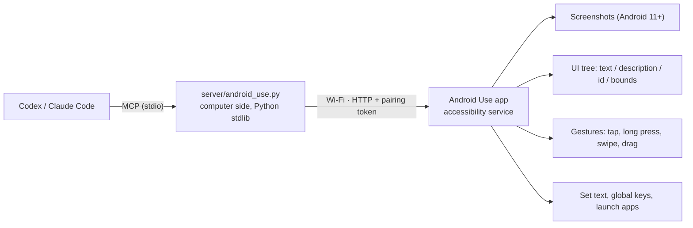

# Android Use

[](https://github.com/dongsenlin/android-use/actions/workflows/test.yml)
[](https://github.com/dongsenlin/android-use/releases/latest)
[](LICENSE)


[中文](README.md) · **English**

Let AI agents such as Codex and Claude Code operate your real Android phone over **Wi‑Fi**: take screenshots, read on-screen text, tap, long-press, swipe, type (including Chinese and emoji), press Back/Home, and open apps or links.

- **Phone side**: a small app built on an Accessibility Service. No ADB, no Developer Mode, no cable.
- **Computer side**: an MCP server plus two skills, installable into both Codex and Claude Code.

The idea comes from [@quanruzhuoxiu's post](https://x.com/quanruzhuoxiu/status/2110026589195076013): an on-device app controls the phone visually, and Codex drives it wirelessly. The tool design and plugin layout follow [iPhone Use](https://github.com/zhongerxin/iPhone-use): confirm the phone is ready first, act optimistically, fall back to a screenshot when the UI looks off, and verify only the results that matter.


## How it works



The agent looks at the screenshot to decide where to act. The UI tree supplements it for reading text and locating buttons precisely.

## Install

```sh
git clone https://github.com/dongsenlin/android-use.git
cd android-use
```

### 1. Phone

1. Download `android-use-0.1.2.apk` from [Releases](https://github.com/dongsenlin/android-use/releases/latest), or build it yourself with `sh app/build.sh`. Install it on the phone. Requires Android 11 or later.
   - To get the APK onto the phone, `python3 scripts/serve_apk.py` serves it on your LAN.
   - If Play Protect warns about an unknown app, choose "Install anyway".
2. Open Android Use:
   - **① Enable the accessibility service.** If the switch is greyed out (Android 13+ restricts sideloaded apps), open App info → ⋮ → "Allow restricted settings" first.
   - **② Turn on "Allow Agent remote control".**
   - **③ Copy the pairing info**, which looks like `androiduse://192.168.x.x:8787/?token=…`.
3. On Xiaomi, Huawei, OPPO, vivo and similar phones, set battery usage to "Unrestricted" and allow auto-start. Otherwise the system may kill the service.

### 2. Computer

```sh
sh scripts/install_codex.sh    # Codex: plugin + skills + MCP
sh scripts/install_claude.sh   # Claude Code: user-scope MCP + skills
```

Start a new chat and say: "Use android-use-setup to pair this phone: androiduse://…". After that, give it tasks directly, for example "On my Android phone, open Settings and tell me whether Bluetooth is on".

The first time the computer connects to the phone, macOS asks for Local Network access; allow it. If the Python process is denied, the server automatically falls back to the system `curl`.

## Tools

| Tool | Purpose |
| --- | --- |
| `android_setup` / `android_doctor` | Pair, show status, step-by-step diagnosis |
| `android_ready` | Check that the phone is online, awake and unlocked; returns a screenshot and the UI tree |
| `android_observe` / `android_find` | Screenshot, UI tree, find elements by selector |
| `android_tap` / `android_long_press` / `android_swipe` | Gestures (coordinates are screen pixels) |
| `android_type_text` | Set full text (replace or append), optional IME enter |
| `android_press_key` | Back, Home, Recents, notifications, quick settings, lock screen, enter |
| `android_apps` / `android_launch_app` / `android_open_url` | List apps, launch by name or package, open links |
| `android_wait` / `android_scroll_find` / `android_batch` | Wait for an element, scroll until found, run known steps in a batch |

## Security

- **Two switches.** The user has to enable the accessibility service in system settings. Remote control is off by default.
- **Pairing token.** A 120-bit random token is required on every request. Regenerating it on the phone revokes the old one immediately.
- **LAN only.** The phone accepts connections only from LAN and loopback addresses.
- **Visible and stoppable.** A purple bar in the status bar shows when an agent is in control; tapping it pauses remote control. The bar avoids notches and punch-hole cameras and never covers app content. Agent gestures that land on it are rejected (`blocked_by_overlay`).
- **No telemetry.** Screenshots stay on your computer in `~/.local/share/android-use/artifacts/` (owner-only, last 60 kept).
- **Ground rules in the skills.** Payments, sending messages and deletions require explicit user confirmation. Passwords and verification codes are entered by the user.

**Limitations**

- Traffic is plain HTTP. Anyone who can sniff your LAN can see screenshots and the token, so only enable remote control on networks you trust.
- The phone cannot be unlocked remotely.
- Screens marked secure (payments, banking) capture as black.

## Compatibility

| Device | OS | Result |
| --- | --- | --- |
| Pixel 6 emulator (incl. emulated notch) | Android 15 | ✅ All features; 13-step flow × 8 runs, 104/104 steps passed |
| LG V60 (waterdrop notch) | Android 12 | ✅ Screenshots, UI tree, Chinese input, batches, bar avoids the notch |

Not yet tested on Xiaomi, Huawei, OPPO, vivo or Samsung skins. Reports are welcome in [Discussions](https://github.com/dongsenlin/android-use/discussions/categories/show-and-tell).

## Feedback & contributing

- **Questions and device reports**: use [Discussions](https://github.com/dongsenlin/android-use/discussions).
- **Bugs and feature requests**: open an [issue](https://github.com/dongsenlin/android-use/issues/new/choose). Remove your pairing token first.
- **Security vulnerabilities**: report them [privately](https://github.com/dongsenlin/android-use/security/advisories/new); see [SECURITY.md](SECURITY.md).
- **Code changes**: read [CONTRIBUTING.md](CONTRIBUTING.md) first.

## Responsible use

Only use Android Use on your own phone and accounts. You remain responsible for what the agent does. Before any payment, message or deletion, the agent asks you to confirm, so read carefully before you agree. Automating some apps may violate their terms or trigger anti-abuse checks. Provided as-is under the MIT License, without warranty.

## Development

```sh
sh app/build.sh                            # build the APK, no Gradle (JDK 17+)
python3 -m unittest discover -s tests -v   # offline tests against a fake phone
python3 server/android_use.py call ready '{}'
```

MIT License. See [CHANGELOG.md](CHANGELOG.md) for changes.
