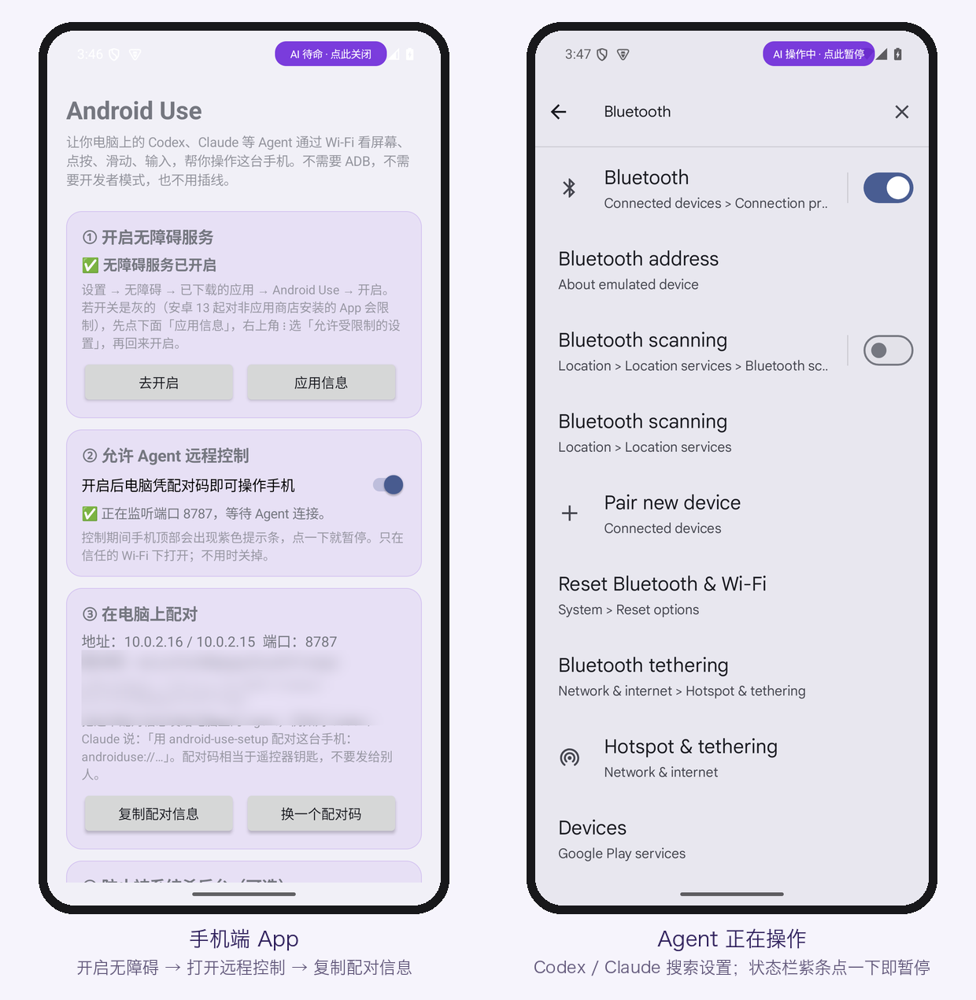
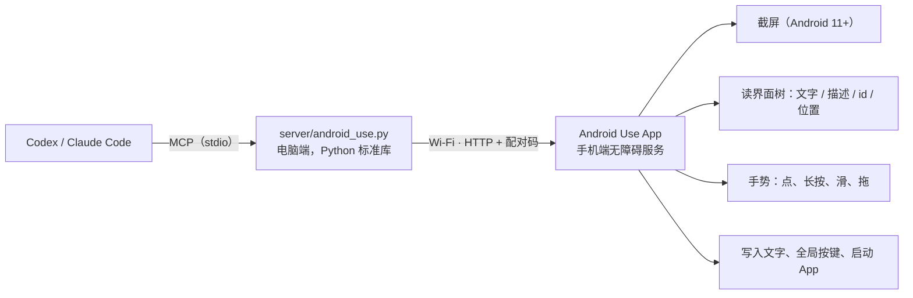

# Android Use

[](https://github.com/dongsenlin/android-use/actions/workflows/test.yml)
[](https://github.com/dongsenlin/android-use/releases/latest)
[](LICENSE)


**中文** · [English](README.en.md)

让 Codex、Claude Code 等 Agent 通过 **Wi‑Fi** 操作你的真实安卓手机：看截图、读界面文字、点击、长按、滑动、输入中文、按返回 / 主页、打开 App 和链接。

- **手机端**：一个 App，核心是无障碍服务。不用 ADB，不用开发者模式，也不用插线。
- **电脑端**：一个 MCP 服务加两个技能，Codex 和 Claude Code 都能装。

思路来自 [@quanruzhuoxiu 的帖子](https://x.com/quanruzhuoxiu/status/2110026589195076013)：在安卓上用 App 做纯视觉控制，再交给 Codex 无线遥控。工具的用法和插件结构参照 [iPhone Use](https://github.com/zhongerxin/iPhone-use)：先 READY 再操作，默认乐观执行，界面异常先看截图，只在关键结果上验收。



## 和 iPhone Use 的区别

| | iPhone Use | Android Use |
| --- | --- | --- |
| 手机端 | 用 Xcode 签名安装 WebDriverAgent | 装一个 APK，在系统设置里开启无障碍 |
| 连接方式 | USB 数据线 + 本机端口转发 | 同一个 Wi‑Fi 直连（也可以用 adb 端口转发） |
| 电脑要求 | 完整 Xcode、Apple 开发者账号 | 只需要 Python 3.8+ |
| 签名过期 | 免费账号 7 天要重签 | 没有这个问题 |
| 认证 | 手机端服务无密码 | 每个请求都要带配对码；只接受局域网连接 |
| 中文输入 | WDA 键盘输入 | 无障碍直接写入，不经过输入法，中文和 emoji 都可以 |

## 工作原理



Agent 自己看截图来决定点哪里，也就是帖子说的"纯视觉"思路。界面树作为补充，用来读文字、精确定位按钮。

## 安装

### 0. 获取代码

```sh
git clone https://github.com/dongsenlin/android-use.git
cd android-use
```

### 1. 手机

1. 从 [Releases](https://github.com/dongsenlin/android-use/releases/latest) 下载 `android-use-0.1.2.apk`（也可以自己 `sh app/build.sh` 打包），传到手机上安装。可以在电脑上运行 `python3 scripts/serve_apk.py`，再用手机浏览器打开它打印的地址；用微信文件传输、网盘或 `adb install` 也行。需要 Android 11 及以上。
   - 安装时如果 Play 保护机制提示"未知应用"或"已屏蔽"，选「仍然安装」（App 没上架商店，所以会被提醒）。
2. 打开 Android Use：
   - **① 去开启**：在无障碍里开启 Android Use。开关是灰的话，先点「应用信息」→ 右上角 ⋮ →「允许受限制的设置」。
   - **② 允许 Agent 远程控制**：打开开关。
   - **③ 复制配对信息**：得到形如 `androiduse://192.168.x.x:8787/?token=…` 的一串。
3. 国产系统（小米、华为、OPPO、vivo 等）建议把电池设为「无限制」、允许自启动，否则无障碍服务会被杀掉。

### 2. 电脑

```sh
sh scripts/install_codex.sh    # 装进 Codex（插件 + 技能 + MCP）
sh scripts/install_claude.sh   # 装进 Claude Code（用户级 MCP + 技能）
```

装完新开一个对话，说："用 android-use-setup 配对这台手机：androiduse://…"，之后就可以直接下任务，比如："用安卓手机打开小红书搜 lookbook，看前 5 条笔记标题"。

macOS 第一次连接手机时会询问是否允许访问本地网络，要点允许。错过了可以去 系统设置 → 隐私与安全性 → 本地网络 里打开。

macOS 会把 Python 当成一个独立的 App 来管这个权限，经常处于没授权的状态。所以电脑端服务被拦时会自动改用系统自带的 curl 连手机，只要宿主程序（Codex、终端、VS Code）有本地网络权限就够了。

## 工具

| 工具 | 作用 |
| --- | --- |
| `android_setup` / `android_doctor` | 配对、查看状态、逐层诊断 |
| `android_ready` | 确认在线、亮屏、已解锁，返回当前截图和控件 |
| `android_observe` / `android_find` | 截图、界面树、按条件找控件 |
| `android_tap` / `android_long_press` / `android_swipe` | 点击、长按、滑动 / 拖动（坐标为屏幕像素） |
| `android_type_text` | 写入完整文字，可替换或追加，可触发回车 / 搜索 |
| `android_press_key` | 返回、主页、最近任务、通知栏、快捷设置、锁屏、回车 |
| `android_apps` / `android_launch_app` / `android_open_url` | 列 App、按名称或包名打开、打开链接 |
| `android_wait` / `android_scroll_find` / `android_batch` | 等控件出现、边滑边找、批量执行已知步骤 |

## 安全设计

- **两道开关**：无障碍服务要用户在系统设置里亲手开启；「允许 Agent 远程控制」默认关闭。
- **配对码**：120 位随机数，每个请求都要带上。在手机上点「换一个配对码」，旧码立即失效。
- **只接受局域网和本机连接**，不对公网开放。
- **随时可停**：控制期间状态栏里有紫色提示条（会避开刘海和挖孔），点一下就暂停；Agent 每次点击的位置会闪一个光圈。提示条放在状态栏里，不会压住 App 的按钮。它只给人点：Agent 的点按、滑动如果落在它上面会被拒绝（`blocked_by_overlay`），不会误把自己关掉。
- **不收集统计数据**。截图只保存在电脑本地的 `~/.local/share/android-use/artifacts/`（仅本人可读，保留最近 60 张）。
- **技能里写明了底线**：付款、发送、删除等操作必须先经用户确认；密码和验证码由用户本人输入。

**已知的限制**：

- 流量是明文 HTTP，同一局域网里能抓包的人可以看到截图和配对码。只在信任的 Wi‑Fi 下开启。
- 无法远程解锁手机。
- 支付、银行等禁止截屏的页面截图会是黑的。

## 兼容性

| 设备 | 系统 | 结果 |
| --- | --- | --- |
| Pixel 6 模拟器（含模拟刘海屏） | Android 15 | ✅ 全部功能；13 步流程连跑 8 轮，104/104 步通过 |
| LG V60（水滴刘海） | Android 12 | ✅ 截图、读界面、中文输入、批量操作、提示条避开刘海 |

还没在小米、华为、OPPO、vivo、三星等国产或定制系统上测过。欢迎到 [Discussions](https://github.com/dongsenlin/android-use/discussions/categories/show-and-tell) 报告你的机型。

## 常见问题

- **需要 root、ADB 或开发者模式吗？** 都不需要，只要在系统设置里开启无障碍服务。
- **能在外面用流量远程控制吗？** 不能。手机只接受局域网和本机的连接，手机和电脑要在同一个 Wi‑Fi。
- **截图是黑的？** 支付、银行等页面禁止截屏，这是系统限制。Agent 会改读界面树，或者请你自己操作。
- **用一阵就断开？** 多半是系统杀了后台服务。把 Android Use 的电池设为「无限制」，再重新开启无障碍。
- **会被 App 检测到吗？** 无障碍服务是系统公开的能力，但个别 App 会限制自动化操作，请遵守各 App 的使用条款。

## 反馈与参与

- **使用问题、机型报告**：到 [Discussions](https://github.com/dongsenlin/android-use/discussions)。
- **Bug 和功能建议**：提 [Issue](https://github.com/dongsenlin/android-use/issues/new/choose)，记得删掉配对码。
- **安全漏洞**：请走[私密报告](https://github.com/dongsenlin/android-use/security/advisories/new)，见 [SECURITY.md](SECURITY.md)。
- **想改代码**：先看 [CONTRIBUTING.md](CONTRIBUTING.md)。

## 使用须知

请只在你自己的手机和账号上使用。让 Agent 操作手机时，你仍然对它的每个操作负责：涉及付款、发送、删除的步骤，Agent 会先请你确认，请看清再同意。自动化操作可能违反部分 App 的条款，或触发风控。本项目按 MIT 许可证"原样"提供，不附带任何担保。

## 开发

```sh
sh app/build.sh                               # 打包 APK，不用 Gradle
python3 -m unittest discover -s tests -v      # 电脑端离线测试（假手机）
python3 server/android_use.py call ready '{}' # 不经过 MCP 直接调用工具
```

构建需要 JDK 17+，以及 Android SDK 的 `platforms;android-35` 和 `build-tools;35.0.0`。

用模拟器做端到端测试时，可以用 adb 开启无障碍并转发端口：

```sh
adb shell settings put secure enabled_accessibility_services \
  com.dongsen.androiduse/com.dongsen.androiduse.AgentService
adb forward tcp:8787 tcp:8787   # 然后配对 url=127.0.0.1:8787
```

完整步骤见 [CONTRIBUTING.md](CONTRIBUTING.md)。

目录结构：

- `app/`：安卓端（Java，无第三方依赖）
- `server/`：MCP 服务（Python 标准库）
- `skills/`：给 Agent 看的使用和安装技能
- `packaging/`：Codex 插件清单
- `scripts/`：安装、卸载和分享 APK 的脚本

APK 的签名钥匙放在 `~/.config/android-use/`，不在仓库里。换一把钥匙签出来的新版本无法覆盖安装旧版本。

更新记录见 [CHANGELOG.md](CHANGELOG.md)。MIT License。
